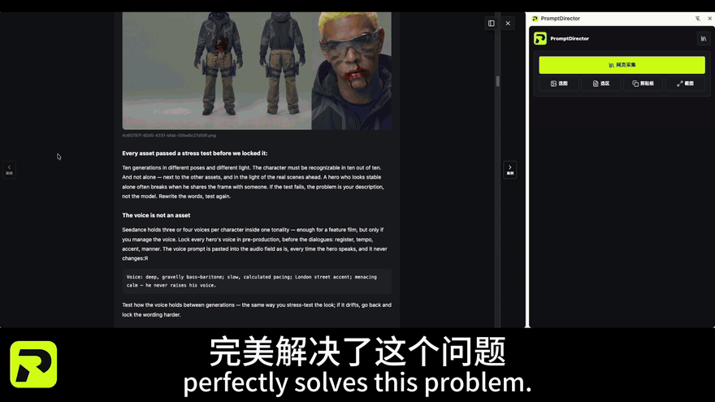
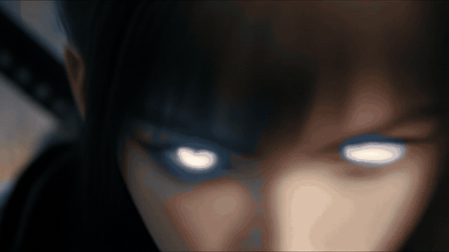
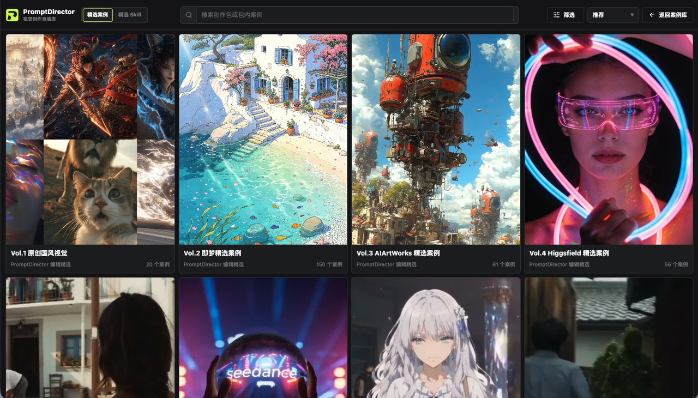
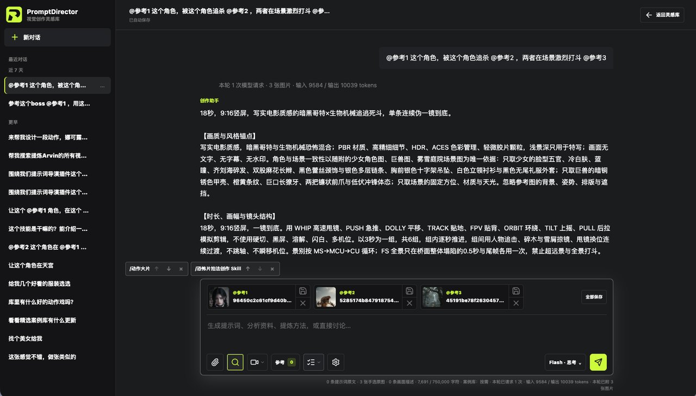

  

<h1 align="center">PromptDirector 提示词导演</h1>

<strong>Spot it. Save it.</strong> 刷到就存，要用就有

  
  
  
  

<strong>English</strong> · <a href="README.zh-CN.md">简体中文</a>

  

   
  <a href="https://www.youtube.com/watch?v=ttbNMJ7Gm7Q">▶ Watch the 71-second demo</a>

- **One click: image + prompt.** Save works, videos and their public prompts from Jimeng, Higgsfield, Midjourney, X, WeChat, Feishu and 20+ sites.
- **A library you browse by eye.** An image-first case wall with tags and projects. It's local-first and needs no account.
- **Your Agent can use it.** Codex, Claude Code and WorkBuddy can search, read and save back to your library through local MCP.

<strong>1,000+ curated cases, ready to import:</strong> <a href="https://wchao6891.github.io/PromptDirector-Curated/en/">Browse (English)</a> · <a href="https://wchao6891.github.io/PromptDirector-Curated/?lang=zh-CN">浏览（中文）</a> · <a href="https://wchao6891.github.io/PromptDirector-Curated/en/guide.html">Quick start</a>

Free & open source · Local first · No account · Chrome / Edge on Windows, macOS, Linux

---

## See it in action

**1 · Spot it, save it.** Open a Higgsfield article and capture it. PromptDirector splits it into cases, keeps each image, video and prompt together and saves them to your library.

**2 · Turn references into a Skill.** Ask the Composer to find a creator's action cases in your library. It reads them and distills a reusable Skill.

**3 · Create with it.** Mix reference images and the Skill in the Composer to write a shot-by-shot video prompt, then generate with your favorite model.

<table>
<tr>
<td width="50%"></td>
<td width="50%"></td>
</tr>
<tr><td align="center"><b>Case wall.</b> Browse by eye, organize by project.</td><td align="center"><b>Capture from X.</b> Even the prompt in the author's reply.</td></tr>
<tr>
<td width="50%"></td>
<td width="50%"></td>
</tr>
<tr><td align="center"><b>Case detail.</b> Media, original prompt and source in one place.</td><td align="center"><b>Curated packs.</b> Import 1,000+ cases in one click.</td></tr>
<tr>
<td width="50%"></td>
<td width="50%"></td>
</tr>
<tr><td align="center"><b>Skill center.</b> Build, import and reuse creative Skills.</td><td align="center"><b>Composer.</b> References + Skill → a ready-to-use prompt.</td></tr>
</table>

## Found a great reference? Start capturing in one click.

**Keep the work and the creative clues behind it.** PromptDirector is a Chrome extension for visual creators. Collect images, videos, text, prompts and sources into a library you can browse visually, organize by project and bring into your next creative conversation.

**Open a work, post or article → Capture → Preview and select → Save cases.**

| Where inspiration lives | What you can bring with you |
| --- | --- |
| **Jimeng · Higgsfield · LiblibAI · Krea · LibTV** | Work images, videos and publicly available prompts or creative details. Keep the visual and its context together. |
| **Midjourney** | Save the selected work, public prompt, parameters and video cover; capture loaded previews from Explore. |
| **HeyBox / 小黑盒 · WeChat articles** | Save a whole article or split clearly structured multi-case posts into selectable image-and-prompt groups. Keep a single HeyBox image gallery with its prompt from the post body. |
| **Feishu documents** | Capture document bodies, long documents and images within tables, preserving cell placement and merged cells. |
| **X / Twitter · Xiaohongshu · Weibo · Reddit** | Collect the current post's text and accessible media, including prompts shared by the author. |
| **Pinterest · Behance · ArtStation · Huaban · ZCOOL** | Bring visual work into one place to browse, search and organize. |
| **More webpages and local files** | General webpage capture, text and image selection, screenshots and local imports help gather scattered materials. |

### One article. A collection of individual references.

For articles with clear case headings or numbering, preview the detected groups under **Cases in article**, select the cases you want and save them individually. Review each image-and-prompt group before saving, or keep the whole article for context.

### Keep the context that makes a reference useful.

Multi-image works stay grouped, articles retain media order and Feishu tables retain their layout. Media, text, original prompts, sources and later analysis have their own place, ready to revisit or use with a model.

Capture, browsing and organization require no AI service. Pages must be accessible and original prompts must be public; login state, lazy loading and site changes can affect results. Preview before saving. Videos are saved locally when a complete file is accessible; supported standalone players and HLS streams can play in the library. See the [capture guide](docs/CAPTURE_SUPPORT.md).

## Your eye chooses. Your Agent takes it further.

**Connect your library to Codex, Claude Code or WorkBuddy.** Search references, read prompts, retrieve originals, capture URLs and save creative materials back to the library through your Agent conversation.

1. Select **Copy connection request** in the extension's **Settings → Agent connection**.
2. Paste it into an Agent with local MCP support so it can install, configure and verify the connector.
3. Enable the connection in Chrome when prompted, then start using your library.

Try requests like:

> “Find character-poster references in my library and list a few options for me to choose.”
>
> “Read the selected cases' original images and prompts, then use them to draft this campaign's visual direction.”
>
> “Save the approved prompt and generated images back to PromptDirector.”

**Google Chrome on Windows, macOS and Linux.** Configuration entry points are provided for Codex, Claude Code and WorkBuddy; other local MCP clients can use the generic configuration. The Agent installs a separate local connector, and the first connection requires browser authorization. Cloud-only workspaces cannot use this local flow. Creative and generation capabilities depend on your Agent and its tools. [Agent setup guide →](connector/INSTALL.en.md)

## Build a library that grows with your creative practice

| What your next project needs | What your library provides |
| --- | --- |
| **A reference you can recognize at a glance** | An image-first case wall, text search and tag filters. Browse the work and choose for yourself. |
| **A focused collection for each project** | Nested projects, related cases and batch management to keep a creative task's materials together. |
| **Experience you can reuse** | The Composer reads selected cases and drafts editable prompts, reusable Skills and tag suggestions for your review. |
| **Room for more than images** | Local images, videos, audio, DOCX, PDFs, Markdown, TXT, HTML, RTF and timestamped video notes. DOCX supports text, tables and embedded images; other Office files and creative source files are preserved as originals for download. |
| **A collection you can share and preserve** | Export cases or project subtrees, create full folder backups, recover on another computer and use encrypted folder sync. |

AI analysis is optional and uses your own service. Selected references help communicate the visual direction you want; only selected or explicitly requested original images are sent to a model. You can also use PromptDirector entirely as a visual reference library.

## Start with curated references

See the image, read the prompt and save what fits your project. Here are a few examples from the current public collection.

<table>
<tr>
<td width="33%"></td>
<td width="33%"></td>
<td width="33%"></td>
</tr>
<tr><td>Celestial ensemble</td><td>War-tent confrontation</td><td>Foxfire paper shadows</td></tr>
</table>

[Browse the curated library →](https://wchao6891.github.io/PromptDirector-Curated/)

These are curated content previews, not demonstrations of platform capture. Refer to each case's source and rights information before reusing its media.

## Your library stays yours

Cases, media, tags and settings are stored in your current browser by default. No account, ads or usage analytics. AI features are opt-in and use your own service keys; the interface explains what will be sent. Read the [privacy policy](https://wchao6891.github.io/PromptDirector-Curated/en/privacy.html).

## Install and update

**For a local installation, download `PromptDirector-<version>.zip` and load its extracted folder in Chrome or Edge.**

Full installation and in-place update instructions

1. Open the [latest GitHub release](https://github.com/wchao6891/PromptDirector/releases/latest) and download `PromptDirector-<version>.zip`.
2. Extract the extension files into a permanent folder named `PromptDirector`, without a version number. `manifest.json` must be at the folder's top level.
3. Open Chrome or Edge's extension management page, enable **Developer mode**, select **Load unpacked**, and choose that folder.

**Updating an existing local installation:** In Settings, check for updates and select the local upgrade action. On first use, choose and authorize the folder Chrome currently loads. Keep that existing location, even if its name contains an old version. The extension downloads, verifies and installs the update, then restarts automatically. Verify the version in Settings and run the temporary-file cleanup action if shown. Cases and media continue to use the same browser library.

You can also install through the [Chrome Web Store](https://chromewebstore.google.com/detail/iahakaahijddcjjldidbclicedibgpjm), which manages subsequent updates.

## Contribute and license

Contributions to capture adaptations, interactions, tests and documentation are welcome. When [reporting an issue](https://github.com/wchao6891/PromptDirector/issues), describe the page type, observable behavior and reproduction steps. Remove API keys, private data and unauthorized media from examples. Run `npm run verify` before submitting code.

See the [development guide](docs/DEVELOPMENT.md) to build and test contributions. The [video component guide](docs/VIDEO_COMPONENT.md) covers the free source package, platform installation checks and optional signed installer builds.

Code is licensed under [Apache License 2.0](LICENSE). See [THIRD_PARTY_NOTICES.md](THIRD_PARTY_NOTICES.md) for dependencies. The code license does not grant rights to third-party case media.
